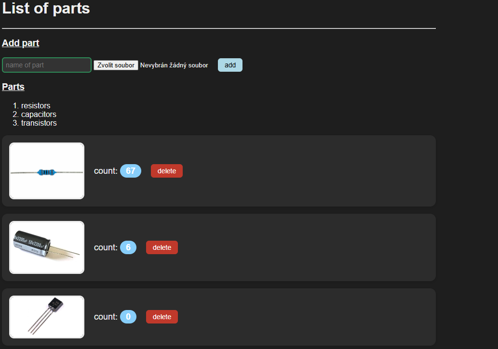
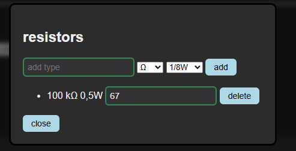
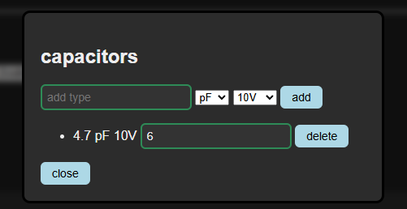

# Stash
Simple inventory counter website made for mainly electricians. Local persistency without a server.
## Usage

When you open index.html in your browser, the main page will open where you can see the added components or add more types of electronic parts.

When you click on the picture of the electrical component, a pop-up window appears where you can add individual quantities and parameters of the given component
## How to run
### Hosted instance
- [Link!](https://kylda-007.github.io/stash)
### Local hosting
Clone the repository. Open `index.html` in a browser or setup a static web server.